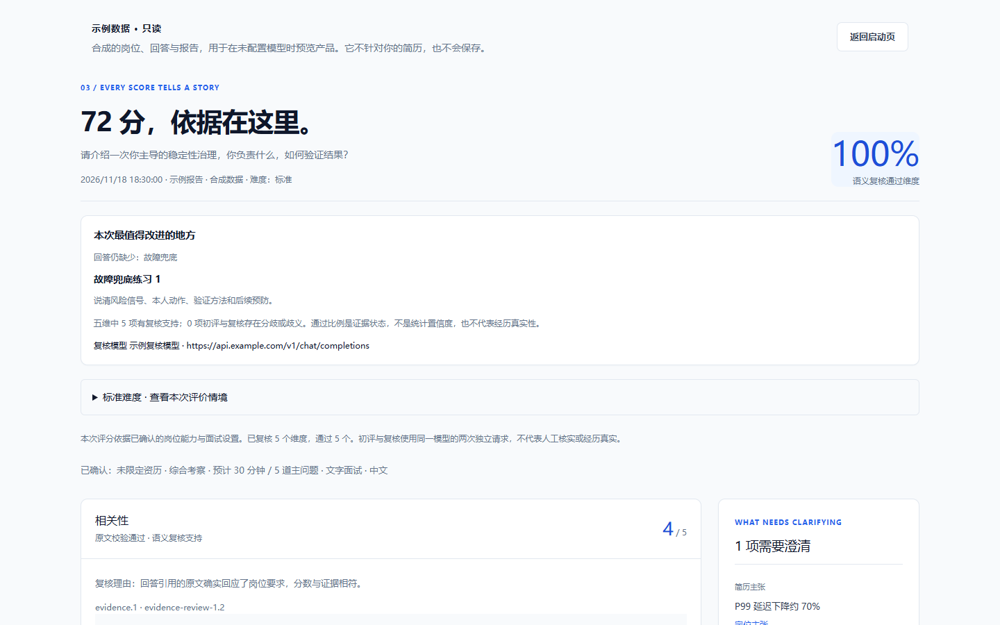
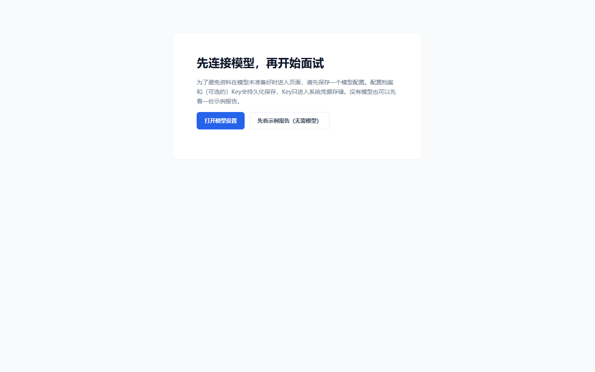
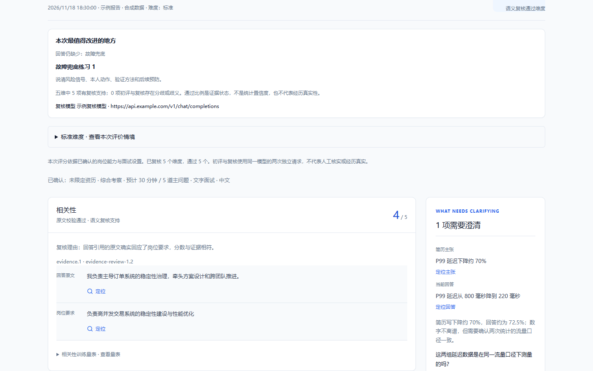
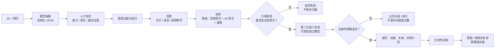

# 面试证据链 · Evidence Loop

[](https://github.com/A-cmd-su/Interview-evidence-chain/actions/workflows/ci.yml)
[](LICENSE)

**把「AI 给面试打分」变成可审计的证据。** 每个分数都必须关联回答连续原文、JD 连续原文和版本化量表；引用对不上原文，请求直接失败；五个维度没有全部通过第二次语义复核，就不发布总分。

仓库名 `interview-evidence-chain`，产品显示名 `Evidence Loop · 面试证据链`。单用户，本机或私有远程使用，不限定岗位和技术栈。



> 截图均为仓库内置的合成示例数据，不针对任何真实简历。

## 为什么做这个

面试训练产品的通病是：给一个看起来专业的分数，却无法回答「凭什么」。这个项目把评估做成一份可核对的账：

- **证据可点开**：每个维度都引用回答原文与 JD 原文，报告里点「定位」就能看到分析时的原文快照和字符位置。
- **分数要过二次复核**：初评之后，另发一次独立请求做语义复核（可指定独立模型）；复核标记为不支持或存在歧义时，不发布该维度分数，并在报告中公开分歧。
- **失败就是失败**：没有离线评分、模拟报告或旧结果兜底路径；模型超时、引用伪造、缺少用量都会显式报错，不会悄悄换成别的东西。

对招聘方而言，这份仓库同时展示三件事：产品判断（什么该发布、什么不该发布）、证据驱动的数据契约，以及 AI 参与开发时如何用测试守住边界。

## 三分钟看效果（无需 API Key）

```bash
npm ci
npm run dev
```

打开 `http://127.0.0.1:5173`，点击 **「先看示例报告（无需模型）」**。示例是只读的合成数据：不调用模型、不写入数据库、不需要配置。



在报告页任选一个维度，点「定位」查看回答原文与 JD 原文；展开「标准难度」查看量表；右侧「需要澄清」列出简历主张与回答数字的对照。



想练自己的题：在启动页点「打开模型设置」，填入任意 OpenAI 兼容服务的地址、模型 ID 和 Key，保存后从 JD 与简历开始。

## 工作流



一次面试支持 15/30/45/60 分钟（3/5/7/8 题），文字、语音、视频三种方式，中文、English、日本語三种目标语言。模型任务先持久化请求 ID，刷新可查回原任务；同 ID 同参数不会重复调用，避免重复计费。

## 核心不变量

数据契约集中在 `shared/analyze.mjs`（`SCHEMA_VERSION = "evidence-loop-3.0"`，`REVIEW_VERSION = "evidence-review-1.2"`）：

1. **引用必须真实存在**：每条证据用 `exactSpan` 对照原文逐字符校验，回答引用和 JD 引用都要能切片还原；伪造或漂移的引用让整次请求失败。
2. **复核后才发布**：`applySemanticReview` 合并第二次模型请求的结论，`isReviewedScore` 只承认证据状态明确的维度；未复核的历史初评不能参与新的分数对比。
3. **可比性受版本控制**：量表、模型、资料或评估参数变化时，分数分组隔离，不做「虚假的进步趋势」。

## 技术实现

- **前端**：React 19 + Vite 6，单页应用，无 UI 框架。
- **服务端**：Node 原生 HTTP 服务（无 Express），SQLite WAL 持久化，同源 `/api`；加 `SERVE_WEB=1` 可单进程同时提供构建产物与 API。
- **模型接入**：Chat Completions 与 Responses 协议适配，兼容云服务、中转和本机模型；输出上限、超时、Token 参数均有显式约束。
- **凭据**：Key 默认仅在后端会话内存保留两小时；Windows 可选写入系统凭据管理器，不进入浏览器存储、SQLite 或备份。
- **访问边界**：默认仅绑定 loopback，校验同源与允许来源；个人远程使用需先 `npm run set-password`、配置 `PUBLIC_ORIGIN` 并通过 HTTPS 反向代理。

## 快速开始

要求 Node.js ≥ 22.13（推荐 24 LTS）。默认前端 `5173`、API `8787`；启动前会检查 Node 版本和端口，不自动终止其他服务。

```bash
npm ci
npm run dev
```

端口冲突时在同一终端改环境变量（程序不自动加载 `.env`）：

```powershell
$env:WEB_PORT = "5176"
$env:API_PORT = "8790"
npm run dev
```

生产构建本机运行：

```bash
npm run build
SERVE_WEB=1 npm run server   # 单进程，默认 http://127.0.0.1:8787
```

Docker、持久数据卷、私有隧道与反向代理见 [个人上线说明](docs/DEPLOYMENT.md)。备份、升级、回滚与诊断见 [交付与维护](docs/OPERATIONS.md)。

## 模型连接

支持 Chat Completions 和 Responses 两种协议，内置 OpenAI、DeepSeek、通义千问、Kimi、Gemini 兼容接口等预设。地址可以填服务根地址、`/v1` 或完整端点，系统不会重复拼接；远程必须 HTTPS，本机可 HTTP。Claude 需通过兼容这两种协议的服务访问。

Key 保存方式、端点拼装规则、超时与预算、错误排查表、代理变量详见 [个人功能指南 · 模型连接与排错](docs/PERSONAL-GUIDE.md#模型连接与排错)。项目没有可用的真实供应商账户，因此**不声称任何模型已通过真实供应商验收**；完整验收入口已内置，需要填入实际账户并确认费用。

## 验证与质量

```bash
npm run check
```

一次执行四层检查：

| 层         | 内容                                                          |
| ---------- | ------------------------------------------------------------- |
| 格式       | Prettier 检查 `src server shared tests scripts docs .github`  |
| 单元 / API | 13 个测试文件、127 项测试（证据校验、幂等、并发、备份、权限） |
| 构建       | Vite 生产构建                                                 |
| 浏览器     | 9 条 Playwright 端到端流程（含无需模型的示例报告路径）        |

GitHub Actions 在 Node 24 + Chromium 上运行同一套检查（`.github/workflows/ci.yml`）。浏览器测试使用独立内存库和测试 HTTP 供应商，不触碰个人数据，也不证明真实模型质量。机器上有进程占用默认测试端口时，可用 `TEST_MOCK_PORT` / `TEST_WEB_PORT` 覆盖。本机验收记录见 [docs/VALIDATION.md](docs/VALIDATION.md)。

关键回归测试保护的行为包括：伪造引用让请求失败、未复核的分数不参与对比、同 ID 任务不重复计费、Key 不落浏览器与备份、跨站请求被拒绝、发布脚本在 Git Bash / Windows 之间可移植。

## AI 协作开发记录

这个项目是 AI 辅助开发的完整样本：AI 参与实现，人负责定义什么才算「对」。

**把协作方式写成仓库内的约束，而不是聊天记录。** [.codex/skills/token-efficient-development/SKILL.md](.codex/skills/token-efficient-development/SKILL.md) 规定了 AI 在本仓库的工作方式：先读再改、限定检索范围、维护紧凑任务账本、复用已校验产物、优先结构化 JSON、失败必须显式报错。其中「证据链不变量」一节是硬约束：任何已发布分数必须引用真实回答片段、岗位要求 ID 和量表 ID，否则只能发布 `insufficient_evidence`。

**职责划分。** 人决定产品范围、证据契约、量表与复核规则、隐私边界和验收标准；AI 按契约实现界面、服务端、测试和文档。AI 不被允许决定「分数是否可信」的规则本身。

**AI 容易犯的错，固化成测试。**

| 风险                           | 约束方式                                             |
| ------------------------------ | ---------------------------------------------------- |
| 编造或漂移引用以凑出高分       | `exactSpan` 逐字符校验 + `tests/evidence.test.mjs`   |
| 跳过第二次复核直接出分         | `isReviewedScore` / `applySemanticReview` + 复核测试 |
| 重试导致重复调用、重复计费     | 持久化任务 ID 幂等 + 刷新恢复测试                    |
| Key 泄漏到浏览器、数据库或备份 | 凭据存储隔离 + 持久化与备份断言                      |
| 跨站请求读取本机 API           | loopback / 同源 / 允许来源校验 + 相关测试            |
| 只在 AI 自己的环境里能跑       | Git Bash / Windows 的 tar 可移植性修复 + 发布测试    |

## 边界与隐私

- 模型复核不等于人工核实：它检查证据与分数是否一致，不判断经历真假，也不保证专业判断准确。
- 岗位覆盖率不是能力分；趋势只在资料、模型、量表和评估配置可比的条件下成立。
- OCR 在浏览器运行，首次需联网下载语言包；语音转写可能把音频发给浏览器供应商或自建的兼容 ASR 服务，均需单独确认；视频默认不上传，只做本地预览与回放。
- 当前按单用户设计：本机 loopback 即可；远程访问需密码 + HTTPS 反向代理。多人隔离与公开服务的出站限制尚未实现。

## 文档

| 文档                                   | 内容                                     |
| -------------------------------------- | ---------------------------------------- |
| [个人功能指南](docs/PERSONAL-GUIDE.md) | 模型分工、预算、训练、语音视频、连接排错 |
| [个人上线](docs/DEPLOYMENT.md)         | Docker、数据卷、隧道、远程访问           |
| [交付与维护](docs/OPERATIONS.md)       | 备份、升级、恢复、诊断、回滚             |
| [验收记录](docs/VALIDATION.md)         | 本机执行过的检查与未覆盖的外部条件       |
| [功能清单](docs/ROADMAP.md)            | 已完成项与边界                           |
| [优化交付](docs/OPTIMIZATION-PLAN.md)  | 长期使用优化的实现与验证                 |

## License

[MIT](LICENSE)
